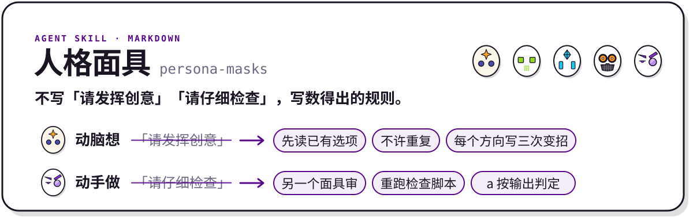
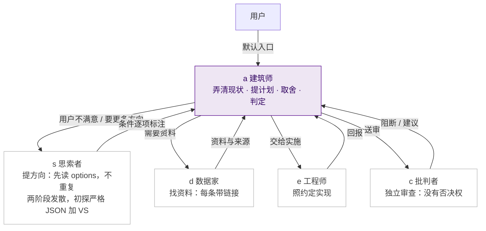
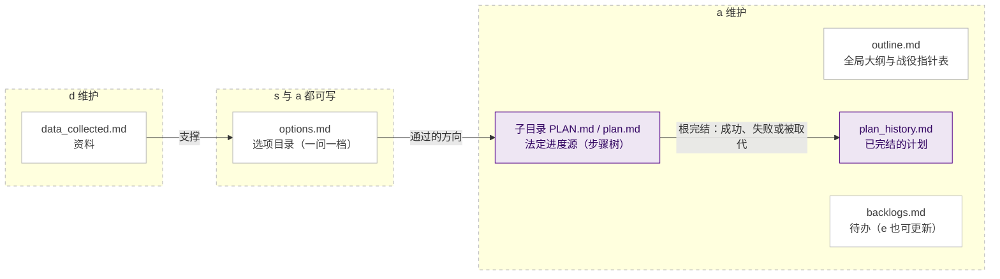

  

# 人格面具 persona-masks

让 AI 助手把「想、做、查」分开的一套轻量角色约定，做成文件型 skill。你只和 `a`（建筑师）对话，由它按需呼叫探索、查资料、实施、审查四个面具；核心只是几份 Markdown 规则，需要更严的流程时，再选装任务书驱动的习惯包。

> 状态：试用版（0.8.1）。a、c、e 的任务书流程已在作者的教科书写作中实际使用；循环 asd 已在作者的真实项目中使用，调整过几次，其中 s 先读 `options.md`、不重复已有方向的规则，作者评价效果显著，但尚未完全验证。没有对照实验证明它比普通提示更有效，也没有强制路由或后台监听，只是一组放在文件里的文字约定。

## 为什么

让一个助手既想方案、又写代码、又自己验收，就是**球员兼裁判**：同一个上下文给自己打分，挑毛病的人也在替你做决定。另一个问题是规则里的**形容词**——「适当」「充分」「值得」「重要」，每个模型、每一次读法都不同：结果难以预测，事后难以审计，也说不清哪里该守规矩、哪里可以放手发挥创意。人格面具针对这两件事：

- **球员不当裁判**：想方案、动手做、挑毛病分给不同的面具；`c` 在独立的上下文里审查，不接收作者的推理，没有否决权；是否合格由 `a` 依据检查脚本的输出与 `c` 的报告判定。
- **用数得出的规则代替形容词**：触发条件、范围与边界写成数得出、查得了的事（几个文件、几行、几天、出现几次）；必须判断强弱的地方，让模型写 0–1 的分数并附依据，规则写明 1 和 0 各代表什么、阈值事先写定，事后回填实际结果、可以校准。规则硬的地方好审计，留给 `s` 发散的地方也因此清楚。
- **轻量、无代码、无安全风险**：只有 Markdown 规则（外加一份只供 Codex 用的元数据），没有可执行代码、服务、数据库或后台进程，也不需要额外权限；规则本身写明不扩大宿主或项目既有的权限。只加载当前角色与启用的模块，Claude Code 与 Codex 都能装；项目里的规矩与经验放在项目自己的 `personas/` 目录，随仓库版控。
- **查资料不凭空**：`d` 要求每条资料带链接，没有来源的说法必须标注。

## 设计取向

- **审查投入随阶段变化。**探路先做最小真实冒烟并抽查，采集审关键门禁，确认阶段做完整审查与回归；任务书写明范围，c 始终独立。未选档时沿用原流程。
- **用规则，不扭曲 agent。**prompt 尽量精简，只写规则：谁做什么、什么不能做、记录放哪里，不要求 agent 改变本性或扮演不属于它的样子。因此它只依赖「能读文件的 agent」，目前对应 Claude Code 与 Codex 的 skills 目录，其他宿主未实测。
- **用刚性规则保证 s 的新意，而不是要求它「发挥创意」。**s 先读 `options.md` 目录与相关的选项档案（独立问题分别派发时只读本问题及相关档案），新方向不得与已有条目重复，初探严格输出 JSON 格式并自动注入 Verbalized Sampling 估算相对典型度；能不能做到，看文件就能核对。
- **搭积木。**系统核心、可选习惯包、项目层三层各自独立，可以只用一块，也可以组合；有预设的工作流（任务书驱动的 a／c／e 循环），也保持自由组合。
- **名字也有规范。**习惯包里规定了 session 的命名格式（角色、实例、任务编号、项目名），多个 session 并行时，通知和查找都靠名字，不靠猜。

五个面具：

| 面具 | 做什么 |
|---|---|
| `s` 思索者 | 暂缓可行性筛选，提出方向；先读 `options.md` 目录与相关档案（独立问题分别派发时只读本问题及相关档案），不与已有方向重复；两阶段发散、初探严格 JSON 输出并自动加 VS 估算 |
| `a` 建筑师 | 对话入口：先弄清现状并写下框定（宏观问题、服务哪个决定、叫停读数），提计划、取舍、判定合格与否 |
| `e` 工程师 | 照约定实现、测量、验证、交付 |
| `c` 批判者 | 挑毛病：独立审查，指出可能错在哪，没有否决权 |
| `d` 数据家 | 找资料、核来源；每条资料带链接，无来源的标注 |

另有四个可以叠加的**共用模块**：`kis`（类比拆解）、`smd`（逐步指导，含教学检查点）、`wid`（把问答写成文件）、`kb`（以自身项目为圆心的三层项目核心知识库，含外部基准与内部自产正负向知识点双源沉淀）；以及两个**循环**：`asd`（用户或 a 定目标，s 思考并呼叫 d 查资料，a 评判可行性，不通过就继续）与 `s-a-d`（s 构思论文或专利的 idea，a 写成查重摘要，用户确认后 d 查重，a 判）。

## 它们怎么协作

项目里的管理文件由对应的面具维护，没有就不建；首次在项目里戴面具时会提示一次，你同意才建：

## 一眼看懂的用法

在对话里用前缀调用：

- `a$kis$smd#Demo/Q1: 帮我理解并逐步完成当前任务。`：以 a 的身份，叠加 kis 与 smd，工作线 `#Demo`，问题 `Q1`；模块也可用冒号连接，写成 `a:kis:smd:`
- 没有写前缀时默认是 a：a 先弄清现状，可以自己提出计划，再按需呼叫 s、d、c、e；你表示不满意、不够有创意或太慢时，a 会自动呼叫 s
- `s: 这个问题有哪些思路？`：直接以 s 进入；回复会标「直接入口，未经 a 判定」，建议改走 `a:`
- 「用 asd 循环：目标……」：启动目标、探索、找资料、判可行的循环
- 「用 s-a-d 循环：题目……」：构思论文或专利的 idea，总结后查重

回复首行会标明当前角色，例如 `〔a 建筑师#Demo/Q1〕`。完整规则见 `persona-masks/SKILL.md`。

## 安装

把整个 `persona-masks/` 文件夹复制到宿主的个人 skills 目录：

- Claude Code：`~/.claude/skills/persona-masks/`
- Codex：`~/.agents/skills/persona-masks/`

两处都装时内容须逐字相同；同一宿主里不要在多个扫描目录重复安装同名包。详见 `persona-masks/INSTALL.md`，其中包括资料目录、可选习惯包与从旧版升级的说明。

## 里面有什么

- `persona-masks/`：包本体
  - `SKILL.md`：入口与路由
  - `references/`：各角色与模块的规则（角色、循环 asd 与 s-a-d、评估、smd、kis、wid、kb、网页端用法、项目层、资料与日志）
  - `templates/`：项目层 `personas/` 与 `kb/` 的模板，含大纲（带工作线与战役指针表）、待办、计划（子项目 `PLAN.md` 或按需建立的森林）、计划历史、选项（目录加一问一档的选项档案）、资料六份管理文件，项目核心知识库四份模板（`kb-PROTOCOL.md`、`kb-theme.md`、`kb-card-external.md`、`kb-card-internal.md`），以及交接模板
  - `habits/`：可选习惯包（任务书驱动的 a／c／e 工作循环、工作手艺、模块调整）
  - `agents/openai.yaml`：只供 Codex 使用的元数据
- `CHANGELOG.md`：版本变更

三层结构：**系统核心**（一定安装）、**习惯包**（逐包询问是否安装）、**项目内容**（不在包内，由使用者在自己的项目里建立）。

## 现状与限制

- 本包只有 Markdown 指令与可选的 Codex 元数据，没有服务、数据库或后台进程。
- 验证程度不同：a、c、e 的任务书流程是作者在教科书写作中实际使用的，取向是质量而不是速度，但没有做过对照实验；循环 asd 是后来加的，调整过几次，已在作者的真实项目中使用，`options.md` 去重的效果作者评价显著，但这是主观评价，没有对照数据，也没有完全验证；其余部分（默认入口、自动呼叫 s、plan 森林、首次提示、s 的两阶段发散与初探严格 JSON 输出加 VS 估算、默认用子 agent 派 e）都是新写的，还没有在多个项目里长期试用；其中 a 读 `options.md` 的范围只是行为规则，没有机制保证。0.5.0 新增的评估字段与校准（可行性、重要性、回填实际结果）、大纲与计划的分层、每个面具写自己的记忆，同样还没有长期试用；评估与校准里的默认值（可撤回 7 天、成本上限 3 天、影响面上限 1、每档最少 5 条、偏差阈值 0.2）是草案值。0.5.1 新增的「无人值守」（用户以明确期限授权后，a 自动派 e、推送工作分支）、a 可以写别的面具的记忆，以及 0.5.2 的 e 返工续用（同一任务书的返工续用原来的 e、在原分支接着提交），同样还没有长期试用。0.6.2 的变异试验、e 的小修额度与整流程预演，同样还没有长期试用。0.7.0 的循环 s-a-d 还没有在真实项目中用过；它的查重只是检索与对照，不是新颖性或可专利性的法律意见。「主 agent 派子 agent、子 agent 只回最后一条消息」这种模式本身，Anthropic 与 OpenAI 都有公开资料，但那不能证明本框架的效果。
- c 与 d 派给哪个工具或命令行，包内不再指定，由使用者在个人 PROFILE 或项目层写明；没写时用宿主的独立上下文（如子 agent）。作者自己的做法是 c 派给一个命令行工具、d 派给另一个，但没有逐一在所有环境实测。
- 网页端没有本机文件系统，只能精简使用（见 `references/web.md`）；网页端的实际限制未经官方文档核实，也未在网页端实测。
- 个人规则与调整日志放在使用者自己的资料目录里，不随包分发。未发布的流程调整（分档、试作、收件核对、盲法与长任务清单等）目前只有规则与模板自查，尚未做真实项目的端到端验证；当前安装版本号为 0.8.1，新追加的未发布改动发布版本待作者决定。s 的新名称为 spark／思索者，使用较低推理强度，独立问题分别派发；kis 表在项目层。a 以全局 `outline.md`（合入带时间戳的工作线与战役指针表）加 `plan_history.md` 为默认主干，子项目资料夹的 `PLAN.md` 为默认法定进度源（多实例计划号按实例隔离，全局仅在开题、转向、结案时同步，久未更新如两个月的计划询问用户是否移入历史并标为搁置），向用户汇报结果时附上具体图表、单集样本与交付物原句草稿，每次自动执行结束后附上 kis 大一通俗三问总结与局部进度 SVG 表；交接只放指针；首选代理不可用时改派自带 subagent 且不多做限制，派工注意防范实验订阅额度挤占；任务书列要求清单且 e 回报偏离由检查脚本比对产出；c 交付查验有构建产物时须看成品；a 派发前置条件明确化且开工新增产物不进 e 的 worktree；brief-workflow 习惯包正式确立任务书「类型：搬运／代码」分工；多实验或公开预注册项目的活体进度源与单实验冻结哈希严格分离（按实验独立抽出自包含冻结规范，早期已绑入单实验预注册哈希的顶层总纲就地封存并分流至 `PROGRESS.md` 与各实验独立计划档）；新增共用模块与项目层组件 `kb`（以自身项目为圆心的 Tier 2/3 渐进式知识库、外部基准与 `internal_{slug}.md` 内部正负向知识点双源沉淀，a 与 d 共同维护并在自主运行收尾同步沉淀）。这些改动尚未做跨项目的广泛对照验证。

## 语言

本仓库是中文版，开发阶段以中文为准；英文版在规则成熟后翻译，另设仓库。

## 相关仓库

同一作者的其他 skill 仓库：

- [chinese-math-forge](https://github.com/asj252/chinese-math-forge)：中文数学教材的写作与审查工具：数学严谨性审查、繁英翻译与习题流水线。
- [myst-textbook-forge](https://github.com/asj252/myst-textbook-forge)：用 MyST 写教科书的工具：章节编辑、视觉风格与 Python 代码整理。
- [writing-forge](https://github.com/asj252/writing-forge)：写作用的 skill：讲解文章的认知审查、忠于原文的简报、README 头图设计。

## 许可证

Apache License 2.0，全文见 [LICENSE](LICENSE)。
