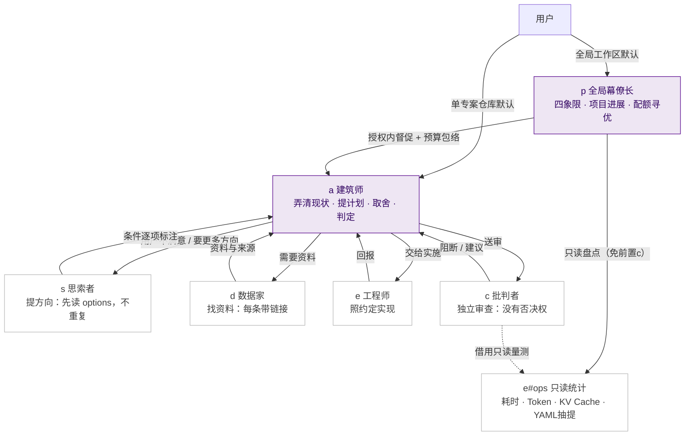
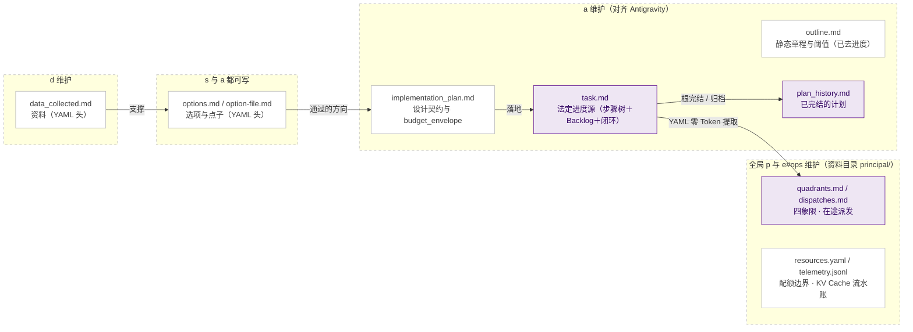

  

# 人格面具 persona-masks

让 AI 助手把「全局统筹、想、做、查」分开的一套轻量角色约定，做成文件型 skill。全局多专案协调时通过 `p`（幕僚长）统揽四象限与项目进展；单专案仓库内你只和 `a`（建筑师）对话，由它按需呼叫探索、查资料、实施、审查四个面具，并用专用只读统计实例 `e#ops` 做零写端盘点；核心只是几份 Markdown 规则，需要更严的流程时，再选装任务书驱动的习惯包。

> 状态：试用版（0.10.0）。a、c、e 的任务书流程已在作者的教科书写作中实际使用；循环 asd 已在作者的真实项目中使用，调整过几次，其中 s 先读 `options.md`、不重复已有方向的规则，作者评价效果显著，但尚未完全验证。没有对照实验证明它比普通提示更有效，也没有强制路由或后台监听，只是一组放在文件里的文字约定。

## 为什么

让一个助手既想方案、又写代码、又自己验收，就是**球员兼裁判**：同一个上下文给自己打分，挑毛病的人也在替你做决定。另一个问题是规则里的**形容词**——「适当」「充分」「值得」「重要」，每个模型、每一次读法都不同：结果难以预测，事后难以审计，也说不清哪里该守规矩、哪里可以放手发挥创意。人格面具针对这两件事：

- **球员不当裁判**：想方案、动手做、挑毛病分给不同的面具；`c` 在独立的上下文里审查，不接收作者的推理，没有否决权；是否合格由 `a` 依据检查脚本的输出与 `c` 的报告判定。
- **交代依据与边界**：说明取舍依据、允许范围和停止条件。简单任务用文字判断；需要正式量化时再定义评分、阈值及回填方式，不把固定评分表套到每次讨论。
- **轻量、无服务、无安全风险**：主体只有 Markdown 规则（外加一份只供 Codex 用的元数据，与一个可选的只读脚本 `scripts/load_mask_context.py`：Python 3 标准库，不联网、不写文件），没有服务、数据库或后台进程，也不需要额外权限；规则本身写明不扩大宿主或项目既有的权限。只加载当前角色与启用的模块，Claude Code 与 Codex 都能装；项目里的规矩与经验放在项目自己的 `personas/` 目录，随仓库版控。
- **查资料不凭空**：`d` 要求每条资料带链接，没有来源的说法必须标注。

## 设计取向

- **审查投入随风险变化。**按任务成本、可撤回性与影响选择冒烟、抽查或完整审查；遵守项目已有门禁，c 始终独立。
- **用规则，不扭曲 agent。**prompt 尽量精简，只写规则：谁做什么、什么不能做、记录放哪里，不要求 agent 改变本性或扮演不属于它的样子。因此它只依赖「能读文件的 agent」，目前对应 Claude Code 与 Codex 的 skills 目录，其他宿主未实测。
- **用刚性规则保证 s 的新意，而不是要求它「发挥创意」。**s 先读 `options.md` 目录与相关的选项档案（独立问题分别派发时只读本问题及相关档案），新方向不得与已有条目重复，初探按管线分隔行格式（`V1`）输出并自动注入 Verbalized Sampling 估算相对典型度；能不能做到，看文件就能核对。
- **搭积木。**系统核心、可选习惯包、项目层三层各自独立，可以只用一块，也可以组合；有预设的工作流（任务书驱动的 a／c／e 循环），也保持自由组合。
- **名字也有规范。**习惯包里规定了 session 的命名格式（角色、实例、任务编号、项目名），多个 session 并行时，通知和查找都靠名字，不靠猜。

六个面具：

| 面具 | 做什么 |
|---|---|
| `p` 幕僚长（全局） | 全局默认入口：只向用户报艾森豪威尔四象限，按项目目标核对结果与证据，已采用科研闭环的项目按其约定督促各仓 `a`，配合预算与轻量评估做模型配额寻优；不拟专案计划、不写业务任务书、不改业务码 |
| `s` 思索者 | 暂缓可行性筛选，提出方向；先读 `options.md` 目录与相关档案（独立问题分别派发时只读本问题及相关档案），不与已有方向重复；两阶段发散、初探按管线分隔行格式（`V1`）输出并自动加 VS 估算 |
| `a` 建筑师 | 单专案默认入口：先弄清现状，按规模说明目标、条件与判据，提计划、取舍、判定合格与否，交代结果、证据与限制 |
| `e` 工程师 | 照约定实现、测量、验证、交付；特设专用只读／统计实例 **`e#ops`** 专供 `p` 盘点并向 `c` 开放借用，严禁改动任何业务文件且豁免前置 `c` 审查（须做最小冒烟） |
| `c` 批判者 | 挑毛病：独立审查，指出可能错在哪，没有否决权；需编写只读量测脚本时可借用 `e#ops` |
| `d` 数据家 | 找资料、核来源；每条资料带链接，无来源的标注 |

另有两个可以叠加的**共用模块**：`kis`（类比拆解）、`kb`（以自身项目为圆心的三层项目核心知识库，含外部基准与内部自产正负向知识点双源沉淀；`wid` 是它的别名，`wid:` 前缀把一则问答写成快照文件）；以及一个由 a 主控的**循环** `asd`（a 定目标与判据，s 构思并展开，d 查资料，a 依据证据裁决，不通过就继续）；说「用 s-a-d 循环」或要给论文、专利的 idea 查重时，开启它的查重子模式（a 写查重摘要，用户确认后 d 逐篇对照查重，a 判）。

## 它们怎么协作

项目里的管理文件由对应的面具维护，复用已有文件；采用 YAML 模板时可供 `e#ops` 读取头部，不要求另建整套工件；全局 `principal/` 四档在启用 `p` 时按需建立：

## 一眼看懂的用法

在对话里用前缀调用：

- `a$kis#Demo/Q1: 帮我理解当前问题。`：以a的身份启用kis，工作线`#Demo`，问题`Q1`；也可写成`a:kis:`
- 没有写前缀时按作用域分层默认：在全局工作区或跨专案控制中心默认是 `p`（只向用户报四象限并按已采用的项目约定督促各仓 `a`）；在单个具体专案仓库内默认是 `a`（`a` 先弄清现状，可以自己提出计划，再按需呼叫 s、d、c、e；你表示不满意、不够有创意或太慢时，`a` 会自动呼叫 s；单专案目录内也可显式写 `p:` 唤起全局视角）
- `s: 这个问题有哪些思路？`：直接以 s 进入；回复会标「直接入口，未经 a 判定」，建议改走 `a:`
- 「用 asd 循环：目标……」：启动由 a 主控的目标、构思、找资料、裁决循环
- 「用 s-a-d 循环：题目……」：同一个循环的查重子模式，构思论文或专利的 idea，总结后经你确认再查重
- `wid: 上面这段`：把这一则问答写成快照文件（`$wid` 则等于启用 `kb`）
- `python3 persona-masks/scripts/load_mask_context.py 'a$kb#Demo/Q1' --cwd <项目>`：可选，按前缀列出当次要读的规则段落与项目记忆路径（`--json` 给机器读）

手动先读 `references/roles.md` 前言与公共常驻，再只读当前 `role-p/s/a/e/c/d.md`；旧标题锚点仍可用，不顺读其他角色。T033 已做本地矩阵／迁移／负例与同环境字符计量；真实 Codex 手动及脚本入口待独立验收，其他宿主与 Python 3.8 解释器未实跑。

旧命令仍可运行；默认只装配 a 常驻职责与 kb 检索入口，并显示动作前补读路由，完整细则保留在 `references/architect-workflows.md`、`references/kb-maintenance.md`。执行动作前按入口表先读；跨阶段读齐，中途转阶段先补读：

- 公共动作：可重复 `--principle write|git|ask|slides|dispatch`；git 自动附 write，派工阶段自动附 dispatch，KB 写动作自动附 write。无角色也可显式读原则，仍受原权限限制。PROFILE 保留旧短表，也可由用户选择短索引＋相邻完整细则；脚本不自动读取私人正文。
- 派工：`python3 persona-masks/scripts/load_mask_context.py a --stage dispatch --cwd <项目>`（无对象时包含 plan、ideate）；明确对象可重复 `--dispatch-to s|d|c|e`，s 附 plan/ideate、d 附 plan、c/e 只附 dispatch；实际写计划／冒烟／长任务／估时仍须 plan。
- 评估／回应：`--evaluation-action assess|respond|backfill`（仅 a）或 `c --evaluation-action check`；可重复，依赖见 evaluation.md。旧 `--stage evaluate` 全读评估并附 ideate；显式 evaluate＋动作采用精确动作读集，其他显式阶段与循环仍保留；普通 asd 自动附 plan、dispatch、ideate、evaluate，循环收尾须补 `--stage close`。
- 收尾：`--stage close`；kb 启用时自动附 write，新增知识卡／主题前补 `--kb-action create`。
- 写卡：`python3 persona-masks/scripts/load_mask_context.py kb --kb-action create --kb-action write --cwd <项目>`；仅修改已有卡可只用 write，但扩充前须补 create。archive 自动附 write；wid: 自动读 snapshot，单独不开启检索与维护。
- 项目日常需规则时读 `references/project-memory.md` 短入口；动作前照表补读 `project-memory-workflows.md`，如 `--project-action setup`（自动附 manage）或 `--project-action freeze`；无角色／模块单用也可显式请求。手动 setup 同样先补读 manage，普通 manage 不加载 setup。默认不追加项目入口／工作流正文。
- KB 启用先读库根 `README.md`（其次已有 `readme.md`）→当前问题相关主题→必要证据；缺索引仅列主题文件名／标题，不因只读查询建档。
- `--stage`、`--kb-action`、`--project-action` 均可重复且去重；非 a 主角色或模块单用指定阶段报错 2。JSON 保留 sections 的 file/heading/text，另列 stages、kb_actions、project_actions 与 pending；project.kb_index 只报告路径和存在性，不表示已读取（触发说明和待补读位置）。脚本不推断自然语言任务、不建目录、不扩权。

回复首行会标明当前角色，例如 `〔p 幕僚长#global〕` 或 `〔a 建筑师#Demo/Q1〕`。完整规则见 `persona-masks/SKILL.md`。

## 安装

把整个 `persona-masks/` 文件夹复制到宿主的个人 skills 目录：

- Claude Code：`~/.claude/skills/persona-masks/`
- Codex：`~/.agents/skills/persona-masks/`

两处都装时内容须逐字相同；同一宿主里不要在多个扫描目录重复安装同名包。详见 `persona-masks/INSTALL.md`，其中包括资料目录、可选习惯包与从旧版升级的说明。

## 里面有什么

- `persona-masks/`：包本体
  - `SKILL.md`：入口与路由
  - `references/`：各角色与模块的规则（角色、循环 asd（含查重子模式）、评估、kis、kb（含别名 wid）、网页端用法、项目层、资料与日志）
  - `scripts/load_mask_context.py`：可选的规则按需装配脚本（Python 3 标准库，只读）
  - `templates/`：项目层 `personas/`、`kb/` 与全局 `principal/` 的全套模板（统一附 `snake_case` YAML Frontmatter），含瘦身大纲、Antigravity 对齐双档（`implementation_plan.md` ＋ `task.md`）、`0.8.x` 旧项目兼容模板（`plan.md`、`backlogs.md`）、计划历史、选项与一问一档选项档案、资料、审查结论（`critic-review.md`）与交接模板，项目核心知识库四份模板（`kb-*`），以及全局 `p` 端四份追踪模板（`principal-quadrants.md`、`principal-dispatches.md`、`principal-resources.yaml`、`principal-telemetry.jsonl`）
  - `habits/`：可选习惯包（任务书驱动的 a／c／e 工作循环、工作手艺、模块调整）
  - `agents/openai.yaml`：只供 Codex 使用的元数据
- `CHANGELOG.md`：版本变更

三层结构：**系统核心**（一定安装）、**习惯包**（逐包询问是否安装）、**项目内容**（不在包内，由使用者在自己的项目里建立）。

## 现状与限制

- 本包是 Markdown 指令，外加可选的 Codex 元数据与一个可选的只读装配脚本（Python 3 标准库，不联网、不写文件），没有服务、数据库或后台进程。
- 验证程度不同：a、c、e 的任务书流程是作者在教科书写作中实际使用的，取向是质量而不是速度，但没有做过对照实验；循环 asd 是后来加的，调整过几次，已在作者的真实项目中使用，`options.md` 去重的效果作者评价显著，但这是主观评价，没有对照数据，也没有完全验证；其余部分（默认入口、自动呼叫 s、plan 森林、首次提示、s 的两阶段发散与初探管线分隔行格式输出加 VS 估算、默认用子 agent 派 e）都是新写的，还没有在多个项目里长期试用；其中 a 读 `options.md` 的范围只是行为规则，没有机制保证。0.5.0 新增的评估字段与校准（可行性、重要性、回填实际结果）、大纲与计划的分层、每个面具写自己的记忆，同样还没有长期试用；评估与校准里的默认值（可撤回 7 天、成本上限 3 天、影响面上限 1、每档最少 5 条、偏差阈值 0.2）是草案值。0.5.1 新增的「无人值守」（用户以明确期限授权后，a 自动派 e、推送工作分支）、a 可以写别的面具的记忆，以及 0.5.2 的 e 返工续用（同一任务书的返工续用原来的 e、在原分支接着提交），同样还没有长期试用。0.6.2 的变异试验、e 的小修额度与整流程预演，同样还没有长期试用。0.7.0 的循环 s-a-d 还没有在真实项目中用过；它的查重只是检索与对照，不是新颖性或可专利性的法律意见。0.10.0 把 s-a-d 并为 asd 的查重子模式、把 `wid` 并为 `kb` 的别名，并新增装配脚本，同样还没有在真实项目中长期试用；脚本按标题切段，规则文件改了标题要同步改脚本。「主 agent 派子 agent、子 agent 只回最后一条消息」这种模式本身，Anthropic 与 OpenAI 都有公开资料，但那不能证明本框架的效果。
- c 与 d 派给哪个工具或命令行，包内不再指定，由使用者在个人 PROFILE 或项目层写明；没写时用宿主的独立上下文（如子 agent）。作者自己的做法是 c 派给一个命令行工具、d 派给另一个，但没有逐一在所有环境实测。
- 网页端没有本机文件系统，只能精简使用（见 `references/web.md`）；网页端的实际限制未经官方文档核实，也未在网页端实测。
- 个人规则、调整日志与按需建立的 `principal/` 全局追踪档放在使用者自己的资料目录里，不随包分发。当前安装版本号为 0.10.0（相对 0.9.0 的变化见 `CHANGELOG.md`；本段以下仍是 0.9.0 的说明）。在保留 `0.8.2` 全部机制（`s` 的 `V1` 管线分隔行＋末组提取、实验冷冻哈希隔离、`kb` 核心知识库、`brief-workflow` 搬运／代码分工与 `0–15` 偏好度选项）的基础上，`0.9.0` 新增全局幕僚长主角色 `p`（作用域分层默认入口、艾森豪威尔四象限 Pull-on-Demand、Claim-Closure 科研认知闭环门禁与 5 轮自动反推、任务书边界配合配额包络与轻量闭集评估做模型寻优）与共用只读／统计实例 `e#ops`（豁免前置 `c` 审查仅做最小冒烟，严禁改专案文件，向 `c` 开放借用），并将项目层工件与 Antigravity `/plan` 格式对齐（瘦身 `outline.md` 为静态章程，新增 `implementation_plan.md` 与合并步骤树／Backlog 的 `task.md`，同时兼容保留 `plan.md` 与 `backlogs.md`；为全部项目层与 `brief-workflow` 模板补齐机器可读 YAML frontmatter 供 `e#ops` 零 Token 抽取，并新增四份 `p` 全局追踪模板）。其中 `s` 第一阶段格式调整参考了 `#connecting-dots/dnli-api` 的单任务消融实验，`p`、`e#ops`、Antigravity 对齐工件与统一 YAML 前置元信息均属 `0.9.0` 新定设计，包内各项改动仍尚未做跨项目的广泛对照验证。

## 语言

本仓库是中文版，开发阶段以中文为准；英文版在规则成熟后翻译，另设仓库。

## 相关仓库

同一作者的其他 skill 仓库：

- [chinese-math-forge](https://github.com/asj252/chinese-math-forge)：中文数学教材的写作与审查工具：数学严谨性审查、繁英翻译与习题流水线。
- [myst-textbook-forge](https://github.com/asj252/myst-textbook-forge)：用 MyST 写教科书的工具：章节编辑、视觉风格与 Python 代码整理。
- [writing-forge](https://github.com/asj252/writing-forge)：写作用的 skill：讲解文章的认知审查、顶会论文六关审查与提交审计、忠于原文的简报、README 头图设计。

## 许可证

Apache License 2.0，全文见 [LICENSE](LICENSE)。

T034未发布调整：通用流程按任务规模选择，数字评分、校准及科研闭环格式不再普遍强制；项目/个人明确采用的要求仍优先。smd与旧t别名已删除，既有个人教学记录保留。
